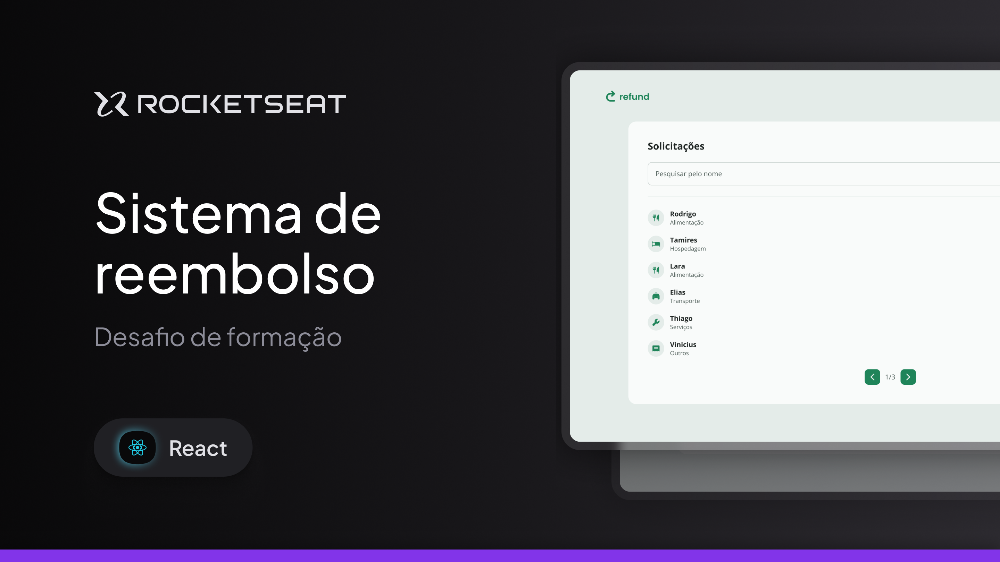

# Refund - Rocketseat React

O **Refund** é uma aplicação de gerenciamento de solicitações de reembolso desenvolvida em **React**, permitindo cadastrar, visualizar, pesquisar e excluir solicitações de despesas de forma simples e organizada.

O projeto foi desenvolvido durante a formação **React da Rocketseat**, com foco na aplicação prática de conceitos fundamentais e intermediários do React, como componentização, gerenciamento de estado, formulários, roteamento, consumo de API, upload de arquivos, busca com debounce e paginação.

---

## 🛠 **Tecnologias e Ferramentas**

Aqui estão as principais tecnologias utilizadas no desenvolvimento deste projeto:

- **React**: Biblioteca para construção da interface e gerenciamento dos componentes
- **Vite**: Ferramenta de build e servidor de desenvolvimento
- **TypeScript**: Tipagem estática para maior segurança e organização do código
- **Tailwind CSS**: Estilização da interface através de classes utilitárias
- **Tailwind Variants**: Criação e gerenciamento de variantes dos componentes
- **React Router**: Gerenciamento das rotas e navegação entre páginas
- **React Hook Form**: Gerenciamento e validação dos formulários
- **Zod**: Criação dos schemas e validação dos dados
- **Axios**: Comunicação entre o front-end e a API
- **Radix UI Dialog**: Criação do modal de confirmação para exclusão de solicitações
- **Sonner**: Feedback visual através de notificações Toast
- **vite-plugin-svgr**: Utilização de arquivos SVG como componentes React
- **React Hooks**: Gerenciamento de estados, efeitos e comportamento da aplicação
- **Git e GitHub**: Controle de versão e hospedagem do código
- **Vercel**: Deploy do front-end
- **Render**: Deploy da API

---

## 💻 **Projeto**

Confira abaixo uma prévia e acesse o projeto completo [aqui](https://refundsystemweb.vercel.app/):



---

## ✅ **Funcionalidades**

- Criação de novas solicitações de reembolso
- Upload de comprovantes
- Validação dos dados do formulário
- Listagem das solicitações através da API
- Visualização dos detalhes de cada solicitação
- Abertura do comprovante em uma nova aba
- Exclusão de solicitações com modal de confirmação
- Pesquisa de solicitações pelo nome
- Busca com **debounce** para evitar requisições excessivas à API
- Paginação dos resultados
- Estados de carregamento e tratamento de erros
- Feedback de sucesso e erro através de Toast
- Navegação entre páginas utilizando React Router
- Componentes reutilizáveis e estilizados através de variantes
- Integração completa entre front-end e API REST

---

## 🔄 **Integração com API**

O projeto consome uma **API REST disponibilizada pela Rocketseat**, responsável pelo gerenciamento das solicitações de reembolso e armazenamento dos comprovantes.

🔗 **Repositório da API:** [rocketseat-education/refund-api](https://github.com/rocketseat-education/refund-api)

O front-end realiza a comunicação com a API através do **Axios**, com a camada de serviços organizada separadamente das páginas e componentes da aplicação.

Entre as operações realizadas estão:

- `GET` para listagem e detalhamento das solicitações
- `POST` para criação de solicitações e envio de comprovantes
- `DELETE` para exclusão de solicitações
- Busca através de parâmetros da requisição
- Paginação dos resultados

A URL da API é configurada através de uma variável de ambiente do Vite:

```env
VITE_API_URL=http://localhost:3333
```

---

## ⚙️ Instalação e Execução

Siga os passos abaixo para clonar o projeto e executá-lo localmente em sua máquina:

### ✅ Pré-requisitos

- [Node.js](https://nodejs.org/) instalado
- [Git](https://git-scm.com/) instalado
- [pnpm](https://pnpm.io/) instalado
- [API do Refund](https://github.com/rocketseat-education/refund-api) configurada e em execução

### 📥 1. Clone o repositório

```bash
git clone https://github.com/murilloressineti/refund-system-web
```

### 📂 2. Acesse a pasta do projeto

```bash
cd refund-system-web
```

### 📦 3. Instale as dependências

```bash
pnpm install
```

### 🔐 4. Configure as variáveis de ambiente

Crie um arquivo `.env` na raiz do projeto:

```bash
VITE_API_URL=http://localhost:3333
```

### 🚀 5. Execute o projeto

```bash
pnpm dev
```

---

## 📝 **Licença**

Este projeto está sob a licença **MIT**. Para mais detalhes, consulte o arquivo [LICENSE](./LICENSE).

---

## 👨🏻‍💻 **Autor**

Feito por **Murillo Ressineti**, aluno da Rocketseat e desenvolvedor Front-end. Conecte-se comigo no LinkedIn para mais informações:

[](https://www.linkedin.com/in/murilloressineti/)

---

## 📬 **Contato**

Se você tiver dúvidas, sugestões ou gostaria de discutir sobre o projeto, sinta-se à vontade para entrar em contato!